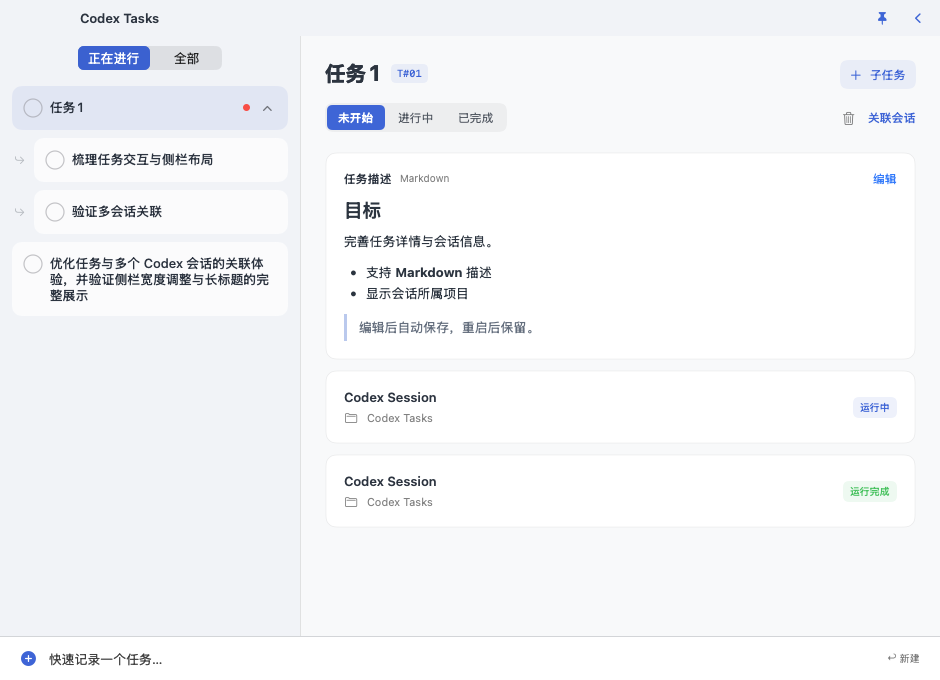
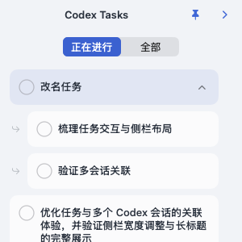

# Codex Tasks

**把任务和 Codex 会话放在一起。**

Codex Tasks 是一个 macOS 原生任务小窗。你可以快速记下待办，为同一任务关联多个 Codex 聊天，查看每个会话的运行状态，再切成置顶小卡片，边工作边跟进。

[下载 macOS 安装包](https://github.com/sunkeycn/CodexTasks/releases/latest) · [所有版本](https://github.com/sunkeycn/CodexTasks/releases) · [反馈问题](https://github.com/sunkeycn/CodexTasks/issues)

支持 **macOS 13 及以上**，同一个通用安装包兼容 **Apple Silicon 和 Intel**。应用免费开源，采用 [MIT 许可证](LICENSE)。



*截图来自隔离示例数据。任务描述、会话状态与项目名可在同一窗口查看。*

## 你可以用它做什么

- **快速记录任务**：输入标题后按回车创建；用「未开始／进行中／已完成」跟进进度。
- **一个任务，多个聊天**：把实现、排查、验证等 Codex 会话归到同一任务，点击卡片返回对应聊天。
- **跟进会话状态**：区分运行中、运行完成、运行失败和状态未知；任务卡片右侧的小圈圈在会话运行时旋转，子任务运行时父任务也会转圈；运行完成后显示未读红点。
- **补充任务说明**：用 Markdown 写目标、步骤、链接或代码片段，编辑自动保存，随时切换预览。
- **管理子任务和顺序**：支持一层子任务、进行中筛选，以及整张任务／会话卡片拖动排序。
- **留一个桌面小窗**：收起详情变成正方形任务卡片，用图钉控制置顶，用快捷键显示或隐藏。
- **本地保存**：任务与关联信息保存在自己的电脑；没有账号登录或应用自建的云同步。

## 安装

1. 打开 [Releases](https://github.com/sunkeycn/CodexTasks/releases/latest)，下载 `Codex-Tasks-版本号-macOS-universal.dmg`。
2. 打开 DMG，把 **Codex Tasks.app** 拖到 **Applications（应用程序）**。
3. 弹出磁盘映像，从「应用程序」启动 Codex Tasks。菜单栏会出现任务清单图标。
4. 点击菜单栏图标 →「设置…」，确认 Codex 数据目录与应用位置。默认数据目录为当前用户的 `~/.codex`，也可以手动选择。

更新时先从菜单栏退出旧版，再用新版替换「应用程序」中的应用。**替换应用不会清空任务数据。** ZIP 附件适合需要直接解压应用的用户；`SHA256SUMS.txt` 提供安装附件的校验值。

### 首次打开的 macOS 提示

当前发布包使用 **ad-hoc 签名，尚未通过 Apple Developer ID 签名及公证**。从 GitHub 下载后，macOS 可能提示无法验证开发者。

仅在你确认下载来源与文件完整性后，先尝试打开应用，再进入「系统设置 → 隐私与安全性」查看「仍要打开」。具体提示与可用操作以系统为准，参见 [Apple 官方说明](https://support.apple.com/zh-cn/102445)。无需关闭系统的安全保护。

## 开始使用

### 1. 记下一个任务

在窗口底部输入任务标题，按回车创建。应用会为任务分配一个编号，并自动复制关联指令，例如：

```text
关联任务【T#01】
```

任务标题可以在右侧直接编辑；描述卡片支持 Markdown，输入后自动保存。任务状态由你手动管理，**会话运行完成不会自动把任务标为已完成**。

### 2. 关联 Codex 聊天

有三种方式：

- **已有聊天**：在 Codex 的用户消息中单独写一行 `关联任务【T#01】` 并发送。多个聊天使用同一任务号，就会归到同一任务。
- **手动选择**：点击右上角「关联会话」，搜索并勾选本机的 Codex 聊天。已属于其他任务的会话会先提示是否移动。
- **新建聊天**：在关联弹窗点击「创建新会话」，打开已预填关联指令的 Codex 草稿；继续输入需求并自行发送。应用不会自动发送消息。

点击关联后的会话卡片，在 Codex 中打开聊天。卡片标题下方展示 Codex 项目名；没有项目时显示「未关联项目」。右键卡片可解除关联。

删除本地任务或解除关联，都不会删除 Codex 聊天。

### 3. 整理和跟进

| 操作 | 使用方式 |
| --- | --- |
| 查看待办 | 「正在进行」展示未开始、进行中的任务；「全部」包含已完成任务 |
| 新建子任务 | 右键主任务选择「新建子任务」，或点击详情右上角「＋ 子任务」 |
| 展开／收起子任务 | 点击主任务右侧箭头；向下箭头表示可展开，向上箭头表示可收起 |
| 调整任务顺序 | 拖动卡片任意位置，在目标卡片上半区／下半区放到前面／后面 |
| 调整会话顺序 | 拖动卡片调整当前顺序；会话后续再次活跃时重新置顶 |
| 读取完成提醒 | 点击带红点的任务；折叠的父任务会汇总子任务提醒 |

任务和子任务默认按创建时间倒序，手动拖动后保留排序，新任务追加到末尾。会话默认按最后活跃时间倒序，也支持手动调整当前顺序；后续新的活跃记录优先于手动排序，即使被拖到底部，再次活跃时也会重新置顶。重复刷新、相同或更旧的活跃记录不会打乱手动顺序，重启后继续保留；各组列表的排序互不影响。

主任务会带着子任务整体移动；子任务只在同一父任务内排序。删除父任务时，子任务会保留并提升到最外层。

## 窗口和快捷键



收起详情后，只保留标题栏和任务列表。展开时恢复原来的正常窗口大小、详情与快速记录区域。左右栏分隔线可以拖动调整宽度。

| 操作 | 默认方式 |
| --- | --- |
| 显示／隐藏窗口 | `⌘⇧空格`；显示时恢复隐藏前的大小、位置和展开状态 |
| 展开／收起详情 | 右上角 `>`／`<`；快捷键不切换大小形态 |
| 置顶／取消置顶 | 箭头左侧图钉；实心蓝色为已置顶，空心灰色为未置顶 |
| 快速记录任务 | `⌘N`，需要时展开窗口并聚焦输入框 |
| 打开设置 | `⌘,`，或菜单栏图标 →「设置…」 |
| 关闭窗口 | 隐藏窗口，应用继续在菜单栏运行 |
| 退出应用 | 菜单栏图标 →「退出」 |

置顶选择、侧栏宽度、任务筛选、子任务折叠与卡片顺序都会保存。设置中可以录制自定义显示／隐藏快捷键；保存后生效，冲突时保留原配置。

## 会话连接和可选 Hooks

应用从本机 Codex 索引与会话日志读取关联和状态，不扫描项目源码目录。默认每 60 秒补查，运行状态超时默认为 180 秒，两项均可在设置调整。没有足够的执行事件或日志长时间未更新时，会话显示「状态未知」。

需要更及时地跟进会话时，可以在设置中选择「安装 / 更新 Hooks」。应用会合并自己的 `UserPromptSubmit`、`Stop`、`Interrupt` 处理器，保留其他工具的配置，并先备份原文件。安装后还需要在 Codex 中审阅并信任该命令；应用不会代替你修改信任记录。

Hooks 助手只记录会话 ID、轮次 ID、状态、时间及明确指定的任务号，不记录聊天正文或工作目录。可在设置中移除本应用的 Hooks。**不安装 Hooks 也可以使用任务管理与会话索引功能。** Codex 本地数据格式变化时，可能需要更新应用适配器。

## 本地数据与迁移

默认数据目录：

```text
~/Library/Application Support/CodexTasks/Lite/
├── tasks.sqlite       任务、描述、子任务、会话关联和顺序
├── settings.json      当前电脑的连接配置
└── Integration/       安装 Hooks 后使用的本地助手与事件
```

应用不包含 Codex 聊天正文，也不会删除 Codex 的聊天文件。未安装 Codex 时仍可以管理任务。

换电脑时，先退出 Codex Tasks，再备份和还原 `tasks.sqlite`；运行中备份请使用 SQLite 在线备份，避免遗漏 WAL。目标电脑重新选择 Codex 数据目录，并按需重新安装、授权 Hooks，不要照搬旧电脑的绝对路径。要打开旧会话，目标电脑上的 Codex 也需要有对应聊天。

更多配置与兼容性信息见 [配置说明](docs/CONFIGURATION.md)。

## 从源码构建

需要 macOS 13+、Xcode Command Line Tools（Swift 5.9+）和系统 SQLite。Swift Package 无第三方包依赖；Markdown 预览资源随应用离线附带。

```sh
git clone https://github.com/sunkeycn/CodexTasks.git
cd CodexTasks
git switch v1-lite
./scripts/test.sh
UNIVERSAL=1 RELAUNCH=0 ./scripts/build-app.sh
./scripts/test-window.sh
UNIVERSAL=1 ./scripts/build-app.sh
./scripts/build-dmg.sh
```

正常交付构建会校验双架构应用和 ZIP，然后关闭本项目旧进程并打开新版。DMG 脚本会检查签名、双架构和最低系统版本，制作可拖入 Applications 的磁盘映像，再只读挂载复验，并生成 SHA-256 校验文件。

| 产物 | 路径 |
| --- | --- |
| 应用 | `outputs/Codex Tasks.app` |
| ZIP | `outputs/Codex-Tasks-macOS.zip` |
| DMG、版本化 ZIP、校验文件 | `outputs/release-v版本号/` |
| 验收报告和原生渲染截图 | `outputs/lite-*.json`、`outputs/lite-*.png` |

`v1-lite` 为当前开发分支，`master` 为发布主分支；重写前的完整版本保留在 `v1-full`。测试与本页截图使用隔离示例数据。

发布流程位于 [GitHub Actions 工作流](.github/workflows/release.yml)：推送与应用版本一致的 `vMAJOR.MINOR.PATCH` 标签后，先运行隔离核心与 Hooks 验收，构建并验签通用应用、ZIP 和 DMG，再上传三个附件并发布 Release。发布说明来自 `docs/releases/`；构建失败时不会执行发布任务。

## 许可证

[MIT License](LICENSE) · Copyright (c) 2026 sunkeycn。

允许使用、修改、商业使用和分发；分发时须保留版权和许可声明。应用包内包含相同许可证。Markdown 预览使用的 Marked、DOMPurify 版本和许可证见 [资源目录](Sources/FloatingWorkbench/Resources/Markdown/)。
